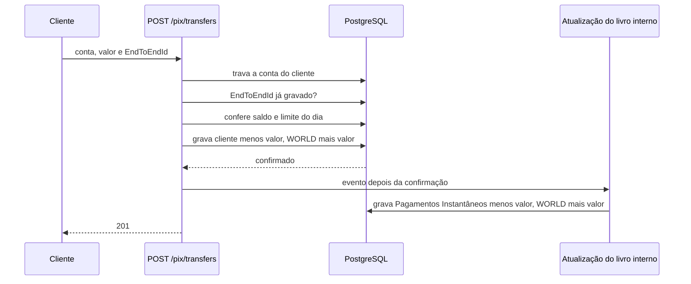

# Ledger de Pix: proposta de arquitetura

Este documento responde ao mini desafio técnico da Cumbuca. Além da proposta, implementei o núcleo dela para comprovar que a política funciona. O código está em https://github.com/joaovictorf01/pix-ledger e as instruções para rodar estão no README.

Todos os valores estão em centavos.

## Premissas

O enunciado fala em três livros-razão e descreve dois. Considerei que o terceiro é a contrapartida externa: o dinheiro que entra no sistema vindo de outras instituições, ou que sai para elas. Sem ele, um Pix enviado aparece como saída do cliente e da conta de pagamentos instantâneos sem entrada em lugar nenhum, e a partida dobrada não fecha. No modelo, cada livro tem uma conta `WORLD` que representa esse lado de fora, e cada livro soma zero sozinho.

O requisito das 18h só faz sentido se, depois desse horário, o dinheiro de Recursos de Clientes deixar de estar disponível. Se ele continuasse disponível, bastaria movê-lo de volta para a conta de pagamentos instantâneos logo depois do fechamento, e a regra não teria efeito. Assumi que às 18h os recursos dos clientes vão para custódia (por exemplo, aplicação em títulos públicos ou conta no Banco Central, como se espera de uma instituição de pagamento) e voltam a ficar disponíveis às 8h do dia seguinte. Os dois horários são configuráveis. É durante essa janela que a Reserva Financeira entra.

"O valor que um cliente possa legitimamente querer transacionar" foi interpretado como o menor entre o saldo do cliente e o que ainda resta do seu limite diário de Pix. Segui a regra do Banco Central para limites: redução vale na hora; aumento só vale depois de 24 horas, para proteger o cliente que é forçado a aumentar o limite durante um golpe. Uma redução feita enquanto um aumento está pendente cancela o aumento.

## Contas e movimentos

O diagrama mostra as contas de cada livro e por onde o dinheiro passa. O Pix movimenta os dois livros ao mesmo tempo; Recursos de Clientes e a Reserva só se movem por operações internas.

## Modelo contábil

Cada movimentação é uma transação com pelo menos duas linhas (lançamentos), todas no mesmo livro, cuja soma é zero. A transação é validada antes de existir: se as linhas não somam zero, se misturam livros ou se uma conta não pertence ao livro, ela não é criada. Os lançamentos nunca são alterados nem apagados; uma correção é um novo lançamento.

Nenhuma conta guarda saldo. O saldo de uma conta é a soma dos seus lançamentos, o que impede que saldo e histórico divirjam.

Cada transação tem uma chave de idempotência única no banco. Para Pix, a chave vem do EndToEndId, então reenviar o mesmo Pix ou receber o mesmo evento duas vezes devolve a transação já gravada, sem mover dinheiro de novo.

O invariante do enunciado é mantido com um termo a mais:

    total dos saldos dos clientes = Recursos de Clientes + Pagamentos Instantâneos - adiantamento da Reserva

Durante o dia o adiantamento é zero, e a igualdade é exatamente a do enunciado. À noite, o dinheiro que a Reserva coloca em Pagamentos Instantâneos é da instituição, não dos clientes, e precisa ser descontado. O adiantamento não é anotado em lugar separado: ele é o capital da Reserva menos o saldo atual dela.

## Fluxo de um Pix

Envio. A conta do cliente é travada no banco (`SELECT ... FOR UPDATE`). Com a trava, verifica-se se o EndToEndId já foi gravado; depois o saldo; depois o limite do dia. Só então a transação do livro de clientes é gravada: cliente menos o valor, `WORLD` mais o valor. A leitura do saldo acontece dentro da trava, porque é isso que impede dois Pix simultâneos de gastarem o mesmo dinheiro. A trava é por conta: Pix de contas diferentes correm em paralelo.

Depois que essa transação é confirmada, um evento atualiza o livro interno, em outra transação: Pagamentos Instantâneos menos o valor, `WORLD` mais o valor. Essa é a consistência eventual pedida: o saldo do cliente muda na hora, e as contas internas acompanham logo em seguida.

Recebimento. Simétrico, sem verificação de saldo. Pix de outras instituições chegariam por uma fila de eventos; no código, um endpoint faz esse papel e chama o mesmo caso de uso que o consumidor da fila chamaria.

## Política de reabastecimento

O alvo de Pagamentos Instantâneos é a soma, para cada cliente, do menor entre o saldo e o que resta do limite do dia. Se a conta tiver pelo menos esse valor, nenhum Pix legítimo falha, mesmo que todos os clientes enviem tudo o que podem ao mesmo tempo.

Um job de reabastecimento roda a cada 5 minutos e compara o saldo de Pagamentos Instantâneos com o alvo. Diferenças até uma tolerância (R$ 100,00 por padrão) são ignoradas, para não gerar movimentos pequenos de ida e volta.

Entre 8h e 18h, o job primeiro devolve à Reserva o que ela adiantou na noite anterior, usando Recursos de Clientes. Depois completa Pagamentos Instantâneos até o alvo, ou devolve o excedente para Recursos de Clientes. A devolução vem primeiro porque o adiantamento é só para a noite e a Reserva precisa estar cheia para cobrir a próxima.

Entre 18h e 8h, Recursos de Clientes está em custódia. Se faltar dinheiro, a Reserva adianta a diferença. Se sobrar, por Pix recebidos durante a noite, o excedente vai abatendo o adiantamento.

## Fechamento das 18h

Às 18h, um job esvazia Pagamentos Instantâneos: o que ainda for adiantamento volta para a Reserva, e o resto, que é dinheiro de clientes, vai para Recursos de Clientes. Nesse momento Recursos de Clientes é igual ao total dos saldos dos clientes, que é o requisito 2. O resultado é gravado na tabela `closings`, uma linha por dia, com os dois valores e se eles bateram; a chave é o dia, então o fechamento não roda duas vezes. Em seguida a Reserva adianta o necessário para a noite.

## Operações internas

As operações internas são dois jobs agendados (reabastecimento e fechamento) e três endpoints para o time interno:

- `GET /internal/invariants` mostra os saldos das contas internas, o alvo, o adiantamento da Reserva e cinco verificações: cada livro soma zero, o invariante acima, Pagamentos Instantâneos cobre o alvo e o adiantamento não é negativo. Cada verificação vem com uma frase explicando o valor encontrado, e o status geral é OK ou ATTENTION. Funciona como painel e como fonte para alertas.
- `POST /internal/rebalance` e `POST /internal/close-of-day` disparam os jobs à mão, para operação e testes.

## Interfaces para clientes

- `POST /customers` abre uma conta, com o limite padrão de Pix.
- `GET /customers/{id}/balance` devolve o saldo.
- `GET /customers/{id}/pix-limit` e `PUT /customers/{id}/pix-limit` consultam e alteram o limite diário; um aumento fica com status `PENDING_INCREASE` e a data em que passa a valer.
- `POST /pix/transfers` envia um Pix; `POST /pix/incoming` simula a fila de Pix recebidos.

Erros seguem o formato de problem details (RFC 9457), com mensagem legível: saldo insuficiente e limite excedido voltam 422, conta inexistente 404 e requisição inválida 400. A documentação OpenAPI fica no Swagger e há arquivos `.http` com as requisições prontas.

## Tecnologias

Java 25 e Spring Boot 4, a stack em que trabalho, para concentrar o esforço no problema e não na ferramenta.

PostgreSQL, porque o ledger depende de garantias que um banco relacional dá de forma nativa: gravar a transação e suas linhas juntas ou nenhuma, rejeitar chave de idempotência repetida com uma restrição única, travar uma linha enquanto um saldo é conferido e somar lançamentos por conta. As regras críticas também estão no banco como restrições (`CHECK`, `UNIQUE` e chaves estrangeiras), como segunda trava além do código.

Flyway para versionar o esquema; o Hibernate apenas valida que as entidades batem com ele.

Testcontainers nos testes de integração, para que concorrência e travas sejam testadas contra um Postgres real. Docker Compose para rodar localmente.

As regras de negócio (soma zero, limite, alvo, horário de funcionamento) ficam em classes de domínio sem dependência de Spring ou banco, e são testadas isoladamente. Cada operação do sistema é um caso de uso próprio.

## Testes

Há testes unitários, que rodam só com Java, e testes de integração com Postgres real. Entre eles: dois Pix simultâneos com saldo para apenas um (um passa, o outro é recusado; sem a trava, o teste falha), reenvio do mesmo EndToEndId, limite com aumento pendente e um dia inteiro simulado (meio-dia, fechamento às 18h, Pix às 22h e reabastecimento às 8h do dia seguinte), conferindo o invariante em cada etapa.

## O que ficou fora e como evoluiria

Fila de eventos. Hoje a atualização do livro interno é um evento dentro da aplicação, disparado depois da confirmação. Se a aplicação parar entre as duas transações, o lado interno fica faltando até ser reprocessado; o painel de invariantes mostra essa diferença. Em produção, usaria o padrão outbox: o evento é gravado na mesma transação do lado do cliente e publicado depois em uma fila, com consumidor idempotente pela mesma chave. O recebimento de Pix de outras instituições usaria a mesma fila, chamando o caso de uso que já existe.

Limite noturno. O Banco Central define um limite próprio entre 20h e 6h. Ele reduziria o alvo noturno e, com isso, o quanto a Reserva precisa adiantar.

Conta de Pagamentos Instantâneos como ponto de contenção. Toda operação que mexe nela passa pela mesma trava, o que é simples e correto, mas limita a vazão em volume alto. A evolução seria dividir a conta em várias subcontas ou agrupar os lançamentos internos em lotes.

Dias não úteis, autenticação dos endpoints internos e alertas automáticos a partir do status ATTENTION também ficaram fora.
