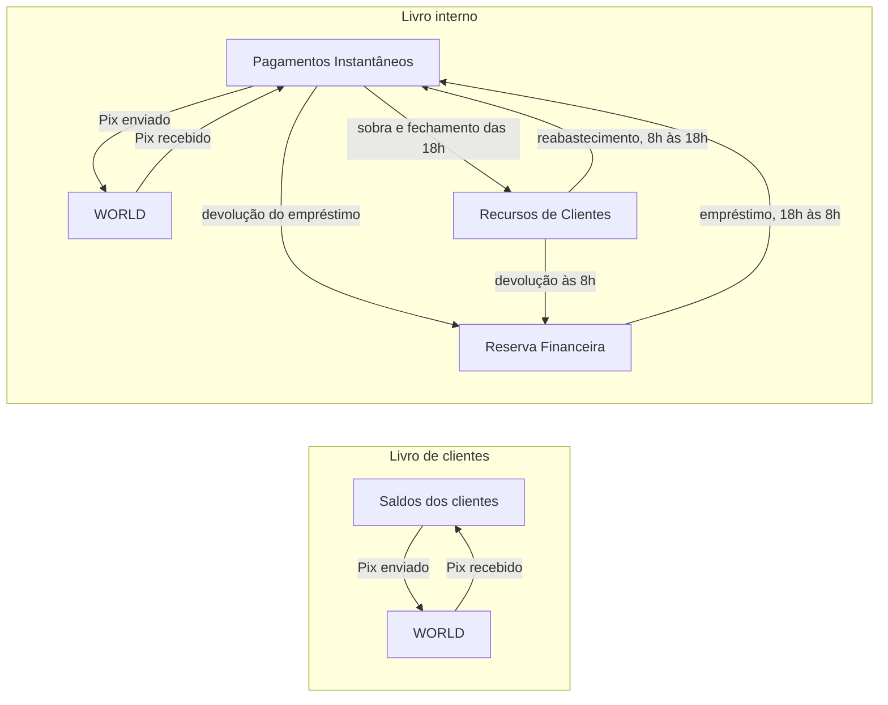
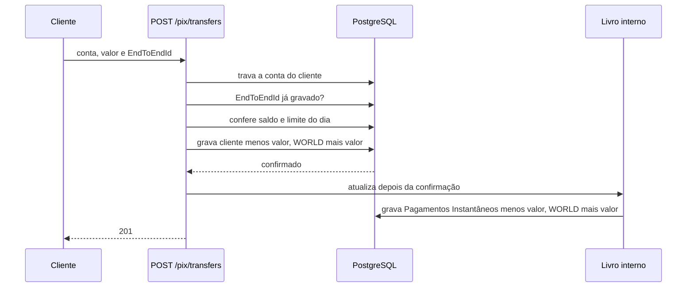

# Desafio Cumbuca: ledger de Pix

Além de escrever a proposta, fiz uma versão em código para testar se a ideia funciona: https://github.com/joaovictorf01/pix-ledger. O README explica como rodar.

## Como eu entendi o problema

São dois jeitos de olhar o mesmo dinheiro. O livro de clientes diz de quem é o dinheiro: quanto cada cliente tem. O livro interno diz onde ele está: em Recursos de Clientes, na conta de Pagamentos Instantâneos ou, no caso do dinheiro da própria instituição, na Reserva Financeira.

O enunciado fala em três livros e descreve dois. Eu tratei o terceiro como o lado de fora: as outras instituições. Quando um cliente manda um Pix, o dinheiro sai do cliente e vai para fora. Sem uma conta representando esse "fora", a saída não teria para onde ir e a partida dobrada não fecharia. Por isso cada livro tem uma conta `WORLD`.

A regra principal é: o total dos saldos dos clientes tem que ser igual a Recursos de Clientes mais Pagamentos Instantâneos. Se não for, dinheiro foi criado ou sumiu.

## Partida dobrada

Toda operação tem pelo menos duas linhas, uma tirando e outra colocando, e as linhas somam zero. Uma operação nunca mistura os dois livros. Se a soma não der zero, a operação nem é criada.

Nenhuma linha é alterada depois de gravada. Se algo estiver errado, entra uma linha nova corrigindo.

O saldo de uma conta não fica guardado em lugar nenhum: é a soma das linhas dela.

## Enviando um Pix

1. Travo a conta do cliente no banco. Se chegar outro Pix da mesma conta ao mesmo tempo, ele espera. Pix de outras contas não esperam.
2. Vejo se esse Pix já foi gravado, pelo EndToEndId. Se já foi, é uma repetição e devolvo o que já existe.
3. Confiro o saldo e o limite do dia. Isso tem que acontecer depois da trava: se dois Pix lessem o saldo ao mesmo tempo, os dois veriam o mesmo valor e os dois passariam.
4. Gravo no livro de clientes: cliente menos o valor, `WORLD` mais o valor.
5. Depois que isso é confirmado, atualizo o livro interno: Pagamentos Instantâneos menos o valor, `WORLD` mais o valor.

O passo 5 é a consistência eventual: o saldo do cliente muda na hora, e o livro interno acompanha logo depois.

Receber um Pix é o mesmo caminho ao contrário, sem conferir saldo. No enunciado esses Pix chegam por uma fila; no código, um endpoint faz esse papel.

## Limite de Pix

Para saber quanto um cliente pode "legitimamente" mandar, usei o limite diário. Segui a regra do Banco Central: diminuir o limite vale na hora; aumentar só vale depois de 24 horas, para proteger o cliente num golpe. Se o cliente pede um aumento e depois uma redução, a redução vale e o aumento é cancelado.

## Quanto deixar em Pagamentos Instantâneos

Para cada cliente, vejo o máximo que ele ainda pode mandar hoje: o menor valor entre o saldo e o que sobra do limite. Somando todos os clientes, tenho o alvo. Se a conta tiver pelo menos isso, nenhum Pix falha, mesmo que todo mundo mande tudo ao mesmo tempo.

Exemplo: Ana tem 70 e limite 50, pode mandar 50. Bia tem 20 e limite 50, pode mandar 20. Caio tem 90, limite 50 e já mandou 40 hoje, pode mandar 10. O alvo é 80.

Um job roda a cada 5 minutos. Se a conta estiver abaixo do alvo, completa com dinheiro de Recursos de Clientes. Se estiver acima, devolve a sobra. Diferenças pequenas (até R$ 100) são ignoradas, para não ficar mexendo o tempo todo.

## O fechamento das 18h

Às 18h, Recursos de Clientes precisa ter exatamente o total dos clientes. Como as duas contas juntas sempre dão esse total, Pagamentos Instantâneos fica zerada nesse momento.

Mas o Pix funciona 24 horas. Se o dinheiro de Recursos de Clientes continuasse disponível depois das 18h, bastaria puxar de volta e a regra não serviria para nada. Por isso assumi que, às 18h, esse dinheiro vai para custódia (aplicado, por exemplo) e só volta às 8h. Os dois horários são configuráveis.

Durante a noite, quem cobre Pagamentos Instantâneos é a Reserva Financeira. É um empréstimo: o dinheiro é da instituição, não dos clientes. Por isso, à noite a regra principal passa a descontar o que a Reserva emprestou. Não guardo esse valor à parte: o empréstimo é o capital da Reserva menos o saldo atual dela.

Às 8h, o job primeiro devolve o empréstimo para a Reserva e só depois completa Pagamentos Instantâneos. A ordem importa: se completasse primeiro, poderia não sobrar dinheiro para devolver, e a Reserva não estaria cheia na noite seguinte.

Cada fechamento fica gravado numa tabela, um registro por dia, com o total dos clientes, o valor de Recursos de Clientes e se os dois bateram.

## Operações internas

São dois jobs, o de reabastecimento e o de fechamento, que também podem ser chamados à mão. Para acompanhar, existe o `GET /internal/invariants`. Ele mostra os saldos das contas internas, o alvo, o empréstimo da Reserva e confere cinco coisas: cada livro soma zero, a regra principal, Pagamentos Instantâneos cobre o alvo e o empréstimo não é negativo. Cada item vem com uma frase explicando, e o resultado geral é OK ou ATTENTION.

## Endpoints

- `POST /customers`: abre uma conta.
- `GET /customers/{id}/balance`: saldo.
- `GET` e `PUT /customers/{id}/pix-limit`: consulta e altera o limite.
- `POST /pix/transfers`: envia um Pix.
- `POST /pix/incoming`: recebe um Pix (simula a fila).
- `GET /internal/invariants`, `POST /internal/rebalance`, `POST /internal/close-of-day`: operações internas.

Os valores são em centavos. Os erros vêm em formato padrão (RFC 9457): saldo insuficiente ou limite estourado dão 422.

## Tecnologias

- Java 25 e Spring Boot 4, que é a stack com que trabalho.
- PostgreSQL, porque o ledger precisa gravar todas as linhas de uma operação juntas, recusar chave repetida e travar a conta enquanto confere o saldo. Isso um banco relacional faz bem. As regras mais importantes também estão no banco (nenhuma linha com valor zero, chave única, chaves estrangeiras).
- Flyway para criar as tabelas.
- Testcontainers para testar com um Postgres de verdade, principalmente a parte de concorrência.

## Testes

Há testes das regras sem banco e testes com banco real. Os principais: dois Pix ao mesmo tempo com saldo para um só (um passa e o outro é recusado; sem a trava, o teste falha), o mesmo Pix enviado duas vezes, o limite com aumento pendente e um dia inteiro simulado, do meio-dia até a manhã seguinte, conferindo a regra principal em cada etapa.

## O que ficou de fora

- Hoje a atualização do livro interno acontece dentro da aplicação. Se ela cair entre um passo e outro, o livro interno fica faltando até ser refeito (o `/internal/invariants` mostra a diferença). Em produção, eu gravaria o evento junto com a operação do cliente e publicaria numa fila depois (padrão outbox).
- Limite noturno do Pix (20h às 6h), que diminuiria o quanto a Reserva precisa emprestar.
- Toda operação na conta de Pagamentos Instantâneos passa pela mesma trava. Com muito volume isso vira gargalo, e seria preciso dividir a conta.
- Fins de semana e feriados, autenticação dos endpoints internos e alertas automáticos.
